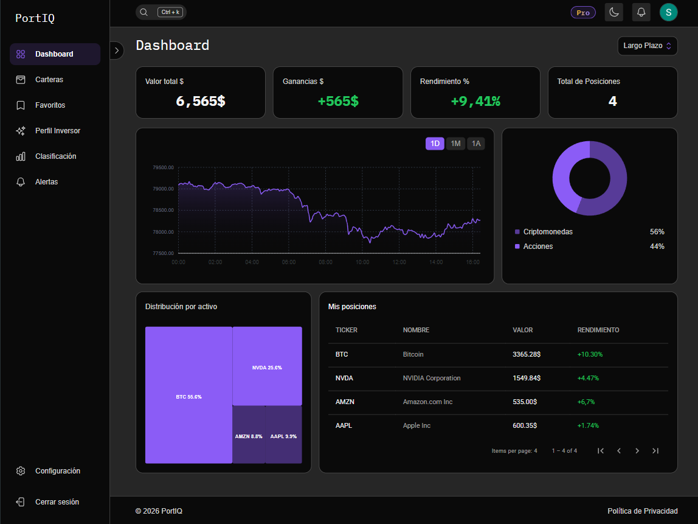

# PortIQ

Aplicación web para gestionar carteras de inversión en acciones, criptomonedas y ETF con datos de mercado reales.

**Demo:** https://portiq-nu.vercel.app



## Funcionalidades

- Búsqueda de acciones, criptomonedas y ETF con precios en tiempo real.
- Carteras con posiciones, compras, ventas e importación desde CSV.
- Dashboard con valor total, rentabilidad y evolución histórica.
- Alertas de precio y notificaciones.
- Plan Pro con pagos mediante Stripe.
- Inicio de sesión con email o con Google.

## Tecnologías

- **Frontend:** Angular 19, TypeScript, Tailwind CSS
- **Backend:** Laravel 12, PostgreSQL, Stripe
- **Datos de mercado:** Python, FastAPI, yfinance
- **Despliegue:** Vercel, Render, Docker

## Ejecutar en local

```bash
# Backend (http://localhost:8000)
cd backend
composer install
cp .env.example .env
php artisan key:generate
php artisan migrate
php artisan serve

# Servicio de datos de mercado (http://localhost:8001)
cd market-service
pip install -r requirements.txt
uvicorn main:app --reload --port 8001

# Frontend (http://localhost:4200)
cd frontend
npm install --legacy-peer-deps
npm start
```

## Equipo

Proyecto final del CFGS en Desarrollo de Aplicaciones Web (INS Provençana, 2026), desarrollado por Solaymane Roukdi, [COMPAÑERO 2] y [COMPAÑERO 3].
